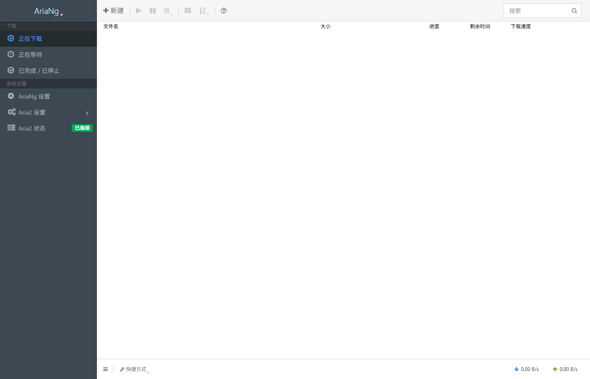

<div align="center">

# Aria2 便携版 · Windows 免安装下载器

**aria2 引擎 + AriaNg 网页面板 + 浏览器扩展接管**，一套脚本把配置、密钥、快捷方式全自动搞定。

替代 IDM 或浏览器自带下载：多线程加速、断点续传、直链 / 磁力 / 种子。

[](#)
[](#)
[](LICENSE)

</div>



---

## 这是什么

Aria2 本身是个只有命令行的下载引擎，想用得顺手得自己拼零件：写配置文件、设 RPC 密钥、
找面板、装浏览器扩展、处理开机自启。这套东西把这些一次性做完了：

- **解压即用**：不写注册表，只创建桌面快捷方式，整个文件夹可搬走、可删除
- **自动配置**：`install.bat` 生成随机 RPC 密钥、`aria2.conf`、带密钥的面板地址、扩展导入文件
- **面板免登录**：AriaNg 打开就自动连上，不用手填密钥（密钥走 base64url 编码进 URL）
- **浏览器接管**：配合 [Aria2 Explorer](https://github.com/alexhua/Aria2-Explorer) 扩展，网页上点链接直接进 aria2
- **中文说明书**：`app/使用说明.html`，从安装到排错全覆盖

只监听 `127.0.0.1`，不联网、不上报、不收集任何数据。

---

## 快速开始

### 方式一：下载现成的压缩包

到 [Releases](../../releases) 或直接下载 [`dist/Aria2下载器-绿色版.zip`](dist/Aria2下载器-绿色版.zip)：

1. 解压到 `D:\Aria2` 之类的位置（**不要放 `C:\Program Files`**，权限不足写不进配置）
2. 双击 `install.bat`
3. 浏览器安装 **Aria2 Explorer** 扩展 → 选项页「导入/导出」→ 导入生成的 `Aria2-Explorer-配置.json`
4. 双击桌面「Aria2 下载器」

### 方式二：从源码目录直接用

```bash
git clone https://github.com/szzhs-hub/aria2-portable.git
cd aria2-portable/app
# 双击 install.bat，或：
cmd /c install.bat
```

> `app/` 里就是完整的运行时文件；`dist/` 里是打包好的 zip，两者内容一致。

---

## 目录结构

```
.
├─ app/                         ← 便携版运行时（可直接用）
│  ├─ install.bat               安装（生成配置、密钥、快捷方式）
│  ├─ start.bat                 启动引擎并打开面板
│  ├─ stop.bat                  停止引擎
│  ├─ autostart-on.bat          开机自启（写启动文件夹，不写注册表）
│  ├─ autostart-off.bat         取消开机自启
│  ├─ view-log.bat              查看实时日志
│  ├─ uninstall.bat             清理自启项与快捷方式
│  ├─ daemon.vbs                无窗口启动 aria2
│  ├─ setup.ps1                 安装逻辑（生成配置与扩展导入文件）
│  ├─ aria2c.exe                aria2 1.37.0 (win-64bit)
│  ├─ aria-ng/index.html        AriaNg 1.3.15 面板（离线单文件）
│  ├─ conf/aria2.conf.template  配置模板
│  ├─ 使用说明.html / .md        中文说明书
│  └─ LICENSES/                 第三方许可原文
└─ dist/
   └─ Aria2下载器-绿色版.zip     打包好的发布物
```

安装后会额外生成（已在 `.gitignore` 中忽略，不进仓库）：

```
app/conf/aria2.conf        运行配置（含你自己生成的 rpc-secret）
app/conf/aria2.session     任务队列
app/conf/aria2.log         运行日志
app/conf/panel-url.txt     面板地址（含密钥）
app/panel.bat              按本机路径生成的面板启动器
app/Aria2-Explorer-配置.json  扩展导入文件
```

---

## 常见问题

| 现象 | 原因 / 处理 |
|---|---|
| 点了链接没反应 | 大概率正在后台下载，看 `Downloads` 目录或 `view-log.bat` |
| 浏览器里看不到下载条 | 接管式下载的固有表现，浏览器没有发起下载；用面板看进度，或 `Alt+A` 临时关拦截 |
| 面板显示「认证失败」 | 密钥不匹配，重跑 `install.bat` 或用 `panel.bat` 打开 |
| 日志里 `errorCode=18` | 下载目录首尾带了引号，去掉引号或留空用默认目录 |
| 想换下载目录 / 端口 | 改 `app/conf/aria2.conf`，重跑 `install.bat` 会沿用你的改动 |

完整排错见 [`app/使用说明.html`](app/使用说明.html)。

---

## 安全说明

- RPC 只监听 `127.0.0.1`（`rpc-listen-all=false`），局域网内其它机器连不上
- 每次安装生成新的随机密钥，各人互不影响
- 分享压缩包前请删除 `app/conf/aria2.conf`、`app/conf/panel-url.txt`、`app/panel.bat` 等生成物，否则对方会继承你的密钥（虽然只对本机有效）

---

## 许可

- 本项目的脚本与文档：**MIT**，见 [LICENSE](LICENSE)
- 随附的 **aria2c.exe**：aria2 官方构建，**GPLv2**，源码见 <https://github.com/aria2/aria2>，许可见 [`app/LICENSES/aria2-COPYING.txt`](app/LICENSES/aria2-COPYING.txt)
- 随附的 **AriaNg** 面板：**MIT**，见 [`app/LICENSES/AriaNg-LICENSE.txt`](app/LICENSES/AriaNg-LICENSE.txt)
- 浏览器扩展 **Aria2 Explorer**：**MIT**，需自行从扩展商店安装，本仓库不包含

详见 [NOTICE.md](NOTICE.md)。

---

## 致谢

- [aria2](https://aria2.github.io/) — 下载引擎
- [AriaNg](https://github.com/mayswind/AriaNg) — 网页面板
- [Aria2 Explorer](https://github.com/alexhua/Aria2-Explorer) — 浏览器接管扩展